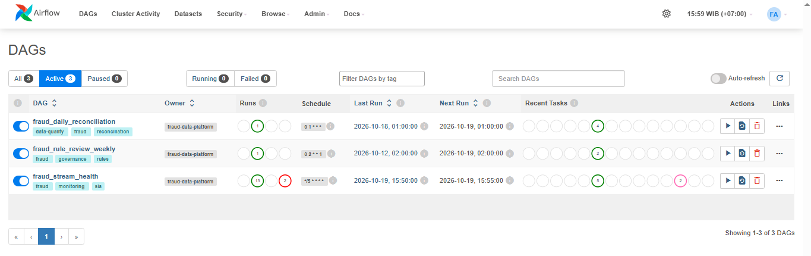
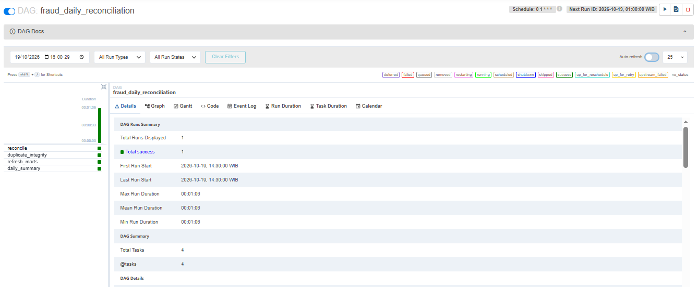
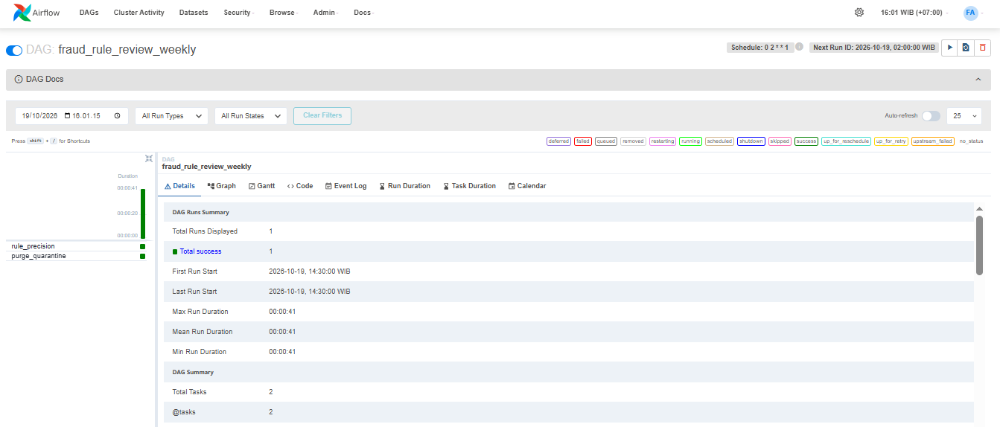
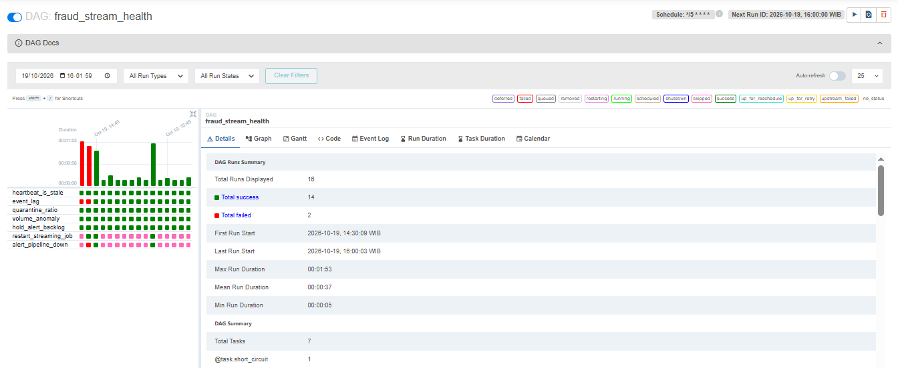

# Banking Fraud & Transaction Intelligence Platform

Platform data engineering end-to-end untuk **deteksi fraud transaksi perbankan secara real-time**:
transaksi dari 5 kanal (Mobile Banking, ATM, Kartu/POS, Internet Banking, feed pihak ketiga) dialirkan
lewat **Apache Kafka**, dinormalisasi, divalidasi, dide-duplikasi dan diberi skor risiko oleh
**Apache Spark Structured Streaming**, lalu disimpan ke **Snowflake** untuk dashboard BI dan konsol
investigasi tim fraud. **Apache Airflow** mengorkestrasi health-check & rekonsiliasi,
**Amazon CloudWatch** memantau pipeline, dan **AWS IAM** + Snowflake RBAC mengamankan akses.

```
SOURCES                REAL-TIME FRAUD DETECTION                                      CONSUMPTION
┌─────────────┐   ┌──────────┐  pull  ┌──────────────────────────────────┐   ┌───────────┐   ┌──────────────────┐
│ Mobile      │──►│          │───────►│ Spark Structured Streaming        │──►│ Snowflake │──►│ BI Dashboards    │
│ ATM         │──►│  Apache  │        │  1. normalisasi 5 format kanal    │   │ CORE/MART │   │ (Metabase/       │
│ Kartu/POS   │──►│  Kafka   │        │  2. validasi DQ -> karantina      │   │ dynamic   │   │  Snowsight)      │
│ Internet Bkg│──►│ txn.raw.*│        │  3. dedup (exact + lintas kanal)  │   │ tables    │   ├──────────────────┤
│ 3rd-party   │──►│          │◄───────│  4. scoring stateful per akun     │   │ (lag ~1m) │──►│ Investigation    │
└─────────────┘   └──────────┘ alerts │     + reason code & penjelasan    │   └───────────┘   │ Console          │
                    fraud.alerts      └──────────────┬───────────────────┘                    └──────────────────┘
                    txn.dlq                          │ arsip raw (bronze) -> S3
        ┌──────────────────────┬─────────────────────┴───┬──────────────────────────────┐
        │ Job Orchestration    │ Monitoring              │ Security                     │
        │ Apache Airflow       │ Amazon CloudWatch       │ AWS IAM (IRSA) + KMS +       │
        │ health / recon / DQ  │ metrics, alarms, SNS    │ Secrets Manager + Snowflake  │
        │                      │                         │ RBAC & dynamic masking       │
        └──────────────────────┴─────────────────────────┴──────────────────────────────┘
```

---

## Masalah → Solusi

| # | Masalah Tim Fraud/Risk | Solusi di platform ini | Di mana |
|---|---|---|---|
| 1 | Transaksi mencurigakan baru diketahui setelah nasabah melapor | Scoring **real-time** (micro-batch 5–10 detik) dengan 11 rule berbasis perilaku per akun (lonjakan nominal, velocity, impossible travel, perangkat baru, card testing, structuring, watchlist, dll). Keputusan `HOLD`/`REVIEW` dipublikasikan ke topik `fraud.alerts` untuk aksi segera | `core/scoring.py`, `streaming/spark_job.py`, `config/rules.yaml` |
| 2 | Format data tiap kanal berbeda | Satu **kontrak kanonik** + normaliser per kanal (ISO-8601 vs epoch vs waktu lokal WIB, nominal desimal vs *minor units*, kode mata uang numerik ISO-4217, konversi ke IDR) | `core/schema.py`, `core/normalizers.py`, `docs/data_contracts.md` |
| 3 | Transaksi duplikat membuat agregat & laporan tidak akurat | Dedup dua lapis di state Spark: **exact** (`idempotency_key`, retry/replay produsen) dan **lintas kanal** (`content_fingerprint`, mis. top-up yang dilaporkan app *dan* e-wallet). Duplikat dicatat di `core.duplicate_events`, tidak memengaruhi profil & selalu dikecualikan dari KPI. Penulisan warehouse idempoten (MERGE / ON CONFLICT) | `core/scoring.py`, `sinks/warehouse.py`, `sql/*/02_marts` |
| 4 | Sulit menelusuri mengapa transaksi ditandai | Setiap skor menyimpan **reason code, bobot, penjelasan bahasa Indonesia dengan angka bukti**, fitur yang dihitung, serta versi & hash konfigurasi rule. Tabel `transaction_rule_hits` + view `v_alert_investigation` + konsol investigasi | `core/scoring.py`, `apps/investigation_console` |
| 5 | Dashboard terlambat karena batch | Streaming end-to-end + Snowflake **Dynamic Tables** `TARGET_LAG = 1 minute` | `sql/snowflake/03_marts.sql` |
| 6 | Tidak ada pemantauan saat pipeline gagal / data tidak lengkap | Heartbeat & metrik per batch, **karantina** dengan kode error, metrik CloudWatch + 6 alarm (pipeline mati, lag, rasio karantina, anomali volume, lonjakan HOLD, query crash), DAG Airflow 5-menitan (auto-restart) & rekonsiliasi harian (*input = unik + duplikat + karantina*) | `monitoring/`, `infra/terraform/cloudwatch.tf`, `airflow/dags/` |

Contoh penjelasan yang tersimpan untuk alert (hasil demo nyata):

```
HOLD  97.1  WATCHLIST_COUNTERPARTY,IMPOSSIBLE_TRAVEL,AMOUNT_SPIKE,NEW_DEVICE_HIGH_VALUE
      Rekening tujuan 9990003333 ada di watchlist (rekening penampung terindikasi)
    | Lokasi berpindah Medan -> Jakarta sejauh 1.424 km dalam 12 menit (~6.901 km/jam)
    | Nominal Rp70.000.000 = 65,1x rata-rata 10 transaksi sebelumnya (Rp1.074.900)
    | Perangkat/kartu baru belum pernah dipakai (3 perangkat dikenal) untuk nominal Rp70.000.000
HOLD  72.5  CARD_TESTING,AMOUNT_SPIKE
      4 transaksi ditolak dalam 15 menit lalu transaksi berhasil | Nominal Rp8.500.000 = 7,2x rata-rata ...
REVIEW 45.0 STRUCTURING
      4 transaksi di kisaran Rp80.000.000-Rp100.000.000 dalam 24 jam (indikasi pemecahan transaksi)
```

## Hasil uji (data simulasi dengan ground truth)

Simulator menghasilkan ~2.300 pesan dalam 6 jam: lalu lintas normal, 21 serangan fraud (7 skenario),
duplikat exact & lintas kanal, serta payload rusak. `fraud-evaluate` membandingkan isi warehouse dengan label:

| Metrik | Hasil |
|---|---|
| Serangan fraud terdeteksi (min. 1 event ditandai) | **21 / 21 (100%)** |
| False positive pada transaksi normal | **0,71%** |
| Transaksi valid yang hilang di warehouse | **0** |
| Duplikat exact tertangkap | **45 / 45** |
| Duplikat lintas kanal tertangkap | **10 / 10** |
| Payload rusak dikarantina | **22 / 22** |

Angka yang sama diverifikasi pada job Spark sungguhan (termasuk restart dari checkpoint dan
pengiriman antar-topik yang tidak berurutan) di `tests/test_spark_job.py`, dan pada job Spark yang
menulis ke PostgreSQL 16. Ketiga DAG Airflow 2.10 dijalankan (`dag.test()`) terhadap warehouse itu,
termasuk skenario pipeline mati (restart dijalankan, alarm terpicu) dan rekonsiliasi harian
(`input 2245 = unik 2190 + exact 45 + lintas kanal 10`, `loaded 2190`). CI menolak perubahan rule bila
deteksi < 95% atau false positive > 2%.

---

## Mulai cepat

Prasyarat: Python 3.10+; Java 17/21 untuk Spark; Docker untuk stack lengkap.

### 1. Demo 1 menit tanpa Docker (pipeline "lite", logika identik)

```bash
python -m venv .venv && source .venv/bin/activate
make install
make demo          # simulasi -> normalisasi/DQ/dedup/scoring -> DuckDB -> evaluasi
make console       # http://localhost:8501  (Fraud Investigation Console)
```

### 2. Job Spark Structured Streaming sungguhan (sumber file, tanpa Kafka)

```bash
make spark-local   # fraud-simulate + fraud-stream --available-now + evaluasi
```

### 3. Stack lengkap dengan Docker (Kafka → Spark → Postgres → BI, + Airflow)

```bash
make up
```

| Layanan | URL | Keterangan |
|---|---|---|
| Kafka UI | http://localhost:8085 | lihat topik `txn.raw.*`, `fraud.alerts`, `txn.dlq` |
| Investigation Console | http://localhost:8501 | KPI, antrean alert, penjelasan, disposisi analis |
| Airflow | http://localhost:8080 | user `admin`, password di `docker compose logs airflow` |
| Metabase (BI) | http://localhost:3000 | tambah database PostgreSQL `postgres:5432/fraud_dw` (fraud/fraud), pakai `bi/dashboard_queries.sql` |

Simulator mengirim ~60 transaksi/menit secara real-time plus serangan fraud acak setiap beberapa menit.
Coba matikan Spark (`docker compose stop spark-stream`) dan lihat DAG `fraud_stream_health` gagal &
mengirim notifikasi; nyalakan lagi dan job melanjutkan dari checkpoint tanpa kehilangan data.

---

## Struktur repository

```
├── config/
│   ├── settings.yaml          # sumber, sink, streaming, validasi, kurs, monitoring (override via env FRAUD__*)
│   └── rules.yaml             # threshold & bobot rule (berversi -> tercatat di setiap skor)
├── src/fraud_platform/
│   ├── core/                  # logika murni, dipakai Spark + pipeline lite + test
│   │   ├── schema.py          #   kontrak data kanonik
│   │   ├── normalizers.py     #   5 format kanal -> kanonik
│   │   ├── validation.py      #   aturan data quality + ingest_message()
│   │   └── scoring.py         #   profil akun, dedup, 11 rule, skor noisy-OR, penjelasan
│   ├── streaming/spark_job.py # topologi Spark Structured Streaming (Kafka/file -> state -> sinks)
│   ├── sinks/                 # writer warehouse idempoten (DuckDB/Postgres/Snowflake), alert publisher
│   ├── monitoring/metrics.py  # emitter metrik (CloudWatch / log)
│   ├── simulator/generator.py # simulator multi-kanal + skenario fraud + label ground truth
│   ├── lite_pipeline.py       # pipeline tanpa Spark (demo, CI, debugging rule)
│   └── evaluate.py            # evaluasi deteksi vs ground truth
├── sql/
│   ├── snowflake/             # setup & RBAC, tabel, masking PII, dynamic tables, alert
│   └── postgres/              # skema lokal (juga dipakai DuckDB)
├── airflow/dags/              # health 5-menitan, rekonsiliasi harian, review rule mingguan
├── infra/terraform/           # S3+KMS, IAM least-privilege (IRSA), Secrets Manager, CloudWatch alarm & dashboard
├── apps/investigation_console # Streamlit untuk tim fraud
├── bi/dashboard_queries.sql   # kartu dashboard BI
├── docker/, docker-compose.yml
├── tests/                     # 67 test: unit, e2e lite, cek Airflow, Spark e2e + restart, konsol
└── docs/                      # arsitektur, kontrak data, runbook
```

## Teknologi

| Lapisan | Lokal (docker compose) | Produksi (AWS) |
|---|---|---|
| Ingestion | Apache Kafka 3.8 (KRaft) | Amazon MSK (IAM auth) |
| Processing | Spark 4.0 Structured Streaming, state RocksDB | Spark on EKS / EMR on EKS, checkpoint di S3 |
| Arsip raw (bronze) | Parquet lokal | S3 (SSE-KMS, lifecycle ke Glacier IR) |
| Warehouse | PostgreSQL 16 / DuckDB | Snowflake (Dynamic Tables, masking, RBAC) |
| Orkestrasi | Airflow 2.10 standalone | Amazon MWAA |
| Monitoring | log metrik JSON + Airflow | CloudWatch metrics, alarms, dashboard, SNS |
| Security | – | IAM IRSA, KMS, Secrets Manager, Snowflake key-pair & network policy |
| Konsumsi | Metabase + Streamlit | Snowsight / BI tool + Streamlit |

## Konfigurasi & deployment produksi

1. `infra/terraform`: salin `terraform.tfvars.example`, `terraform apply` (S3, KMS, IAM role IRSA, secret, alarm).
2. Snowflake: jalankan `sql/snowflake/00_setup.sql` → `04_alerts.sql` berurutan (via CI/schemachange).
3. Isi secret key-pair Snowflake ke Secrets Manager; mount sebagai file ke pod Spark.
4. Deploy image `docker/Dockerfile.spark` ke EKS dengan service account ber-anotasi `stream_role_arn`
   dan env dari `.env.example` (`FRAUD__SOURCE__TYPE=kafka`, `FRAUD__WAREHOUSE__TYPE=snowflake`, `FRAUD__MONITORING__EMITTER=cloudwatch`).
5. Upload `airflow/dags/` ke MWAA; set Connection `fraud_dw` (Snowflake) & Variables
   (`fraud_sns_topic_arn`, `fraud_slack_webhook_url`, `fraud_stream_restart_cmd`).

Mengubah threshold rule: edit `config/rules.yaml`, naikkan `version`, jalankan `make test` (gate deteksi),
deploy ulang. Versi & hash konfigurasi tersimpan di setiap transaksi, jadi keputusan lama tetap bisa diaudit.

## Dokumentasi lanjut

- [docs/architecture.md](docs/architecture.md): alur data, keputusan desain, jaminan exactly-once, skalabilitas
- [docs/data_contracts.md](docs/data_contracts.md): format tiap kanal, skema kanonik, kode DQ, reason code
- [docs/runbook.md](docs/runbook.md): respons alarm & operasional harian


## Monitoring dengan Airflow








