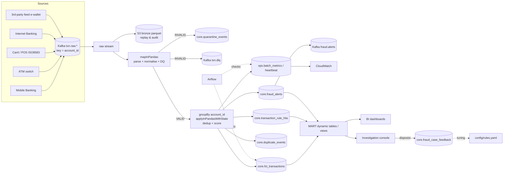

# Arsitektur & Keputusan Desain

## 1. Alur data

Lapisan data (medallion):

| Lapisan | Lokasi | Isi |
|---|---|---|
| Bronze | S3 `bronze/topic=…/ingest_date=…` | payload mentah apa adanya, untuk replay/backfill & audit regulator |
| Silver | `CORE.*` | transaksi kanonik terskor, rule hits, alert, duplikat, karantina |
| Gold | `MART.*` | KPI per jam/hari (dynamic tables), view investigasi, performa rule, DQ |
| Ops | `OPS.*` | metrik per micro-batch, heartbeat, hasil cek Airflow |

## 2. Keputusan desain penting

**Satu codebase logika, dua engine.** Semua aturan bisnis ada di `fraud_platform.core` (Python murni).
Spark memanggilnya lewat `mapInPandas` dan `applyInPandasWithState`; pipeline *lite* memanggil fungsi yang
sama. Hasilnya: rule bisa diuji unit dalam milidetik, dan perilaku di laptop = perilaku di produksi.

**Partisi Kafka berdasarkan `account_id`.** Semua event satu akun berada di partisi yang sama di tiap topik,
dan Spark mengelompokkan state per akun.

**Tidak ada watermark di jalur scoring.** Watermark akan membuat Spark *membuang diam-diam* event yang
terlambat. Di bank setiap transaksi harus tercatat, jadi event terlambat tetap diproses. Rule bersifat
*event-time aware*:
- jendela geser (velocity, card testing, structuring) menyimpan riwayat minimal `late_event_tolerance_hours`;
- impossible travel membandingkan lokasi sebelum **dan** sesudah event (urutan kedatangan antar-topik bisa terbalik);
- duplikat lintas kanal dicocokkan 1-ke-1 dengan kemunculan terdekat dalam waktu.

**Dedup di dalam state, bukan `dropDuplicates`.** Duplikat dicatat (`core.duplicate_events`) sehingga
rekonsiliasi bisa membuktikan *input = unik + duplikat + karantina*. Duplikat tidak memperbarui profil
(velocity, baseline nominal) dan selalu dikecualikan dari KPI. Untuk duplikat lintas kanal berlaku
*first-seen wins*: salinan yang tiba lebih dulu dipertahankan, salinan lain ditandai `is_duplicate`.

**Profil tidak "teracuni".** Transaksi `HOLD` tidak masuk baseline nominal dan perangkat barunya tidak
dianggap dikenal sampai ada transaksi normal dari perangkat itu.

**Skor noisy-OR.** `score = 100 × (1 − Π(1 − wᵢ))`: banyak sinyal lemah terakumulasi, tetapi skor tidak
pernah > 100, dan bobot tiap rule mudah dijelaskan ke tim risk/audit.

**Tidak ada micro-batch kosong.** `noDataMicroBatches.enabled=false` agar timeout state berbasis waktu proses
tidak memicu batch kosong terus-menerus. Konsekuensinya heartbeat hanya bergerak bila ada data, sehingga
alarm "tidak ada batch" juga menangkap sumber yang diam (kondisi yang memang harus diinvestigasi).

## 3. Jaminan pemrosesan (exactly-once effect)

| Komponen | Mekanisme |
|---|---|
| Offset Kafka & state akun | checkpoint Spark (S3) + RocksDB changelog checkpointing |
| `fct_transactions`, `rule_hits`, `alerts` | MERGE / `ON CONFLICT DO NOTHING` pada kunci bisnis |
| `duplicate_events`, `quarantine_events` | `DELETE WHERE pipeline, batch_id` + INSERT dalam satu transaksi |
| metrik & heartbeat | upsert per `(pipeline, batch_id)`; ditulis **terakhir** sehingga heartbeat = data batch sudah commit |
| Produsen | `enable.idempotence=true`, `acks=all` |

Jika job mati di tengah batch, Spark mengulang `batch_id` yang sama dari checkpoint; semua tulisan di atas
idempoten sehingga hasil akhirnya tidak berubah (diuji di `tests/test_pipeline_e2e.py` dan `test_spark_job.py`).

## 4. Skalabilitas

- Throughput diatur dengan `maxOffsetsPerTrigger`, jumlah partisi Kafka (≥ jumlah core executor) dan
  `spark.sql.shuffle.partitions`.
- State per akun dibatasi (riwayat 50 nominal, 20 perangkat, 10 titik lokasi, kunci 24 jam) sehingga
  ukuran state ≈ O(jumlah akun aktif). Akun idle > 30 hari dibuang (`state_idle_timeout`); untuk
  baseline jangka panjang di skala besar, profil bisa di-*bootstrap* dari feature store/warehouse.
- `foreachBatch` → pandas cocok hingga puluhan ribu baris per micro-batch. Untuk volume lebih tinggi
  ganti `SnowflakeSink` dengan Spark Snowflake Connector (staging + MERGE) tanpa mengubah logika.
- Normalisasi berjalan di executor (mapInPandas, Arrow), bukan di driver.

## 5. Pengembangan berikutnya

- Model ML (mis. gradient boosting) sebagai satu "rule" tambahan dengan bobot, memakai label dari
  `core.fraud_case_feedback`; fitur yang sama sudah tersimpan di kolom `features`.
- Schema Registry (Avro/Protobuf) per topik untuk kontrak yang ditegakkan di sisi produsen.
- Kurs harian dari tabel referensi menggantikan `fx_rates_to_idr` statis.
- Prioritas kanal pada duplikat lintas kanal (mis. sistem inti selalu jadi master) dengan koreksi baris lama.
